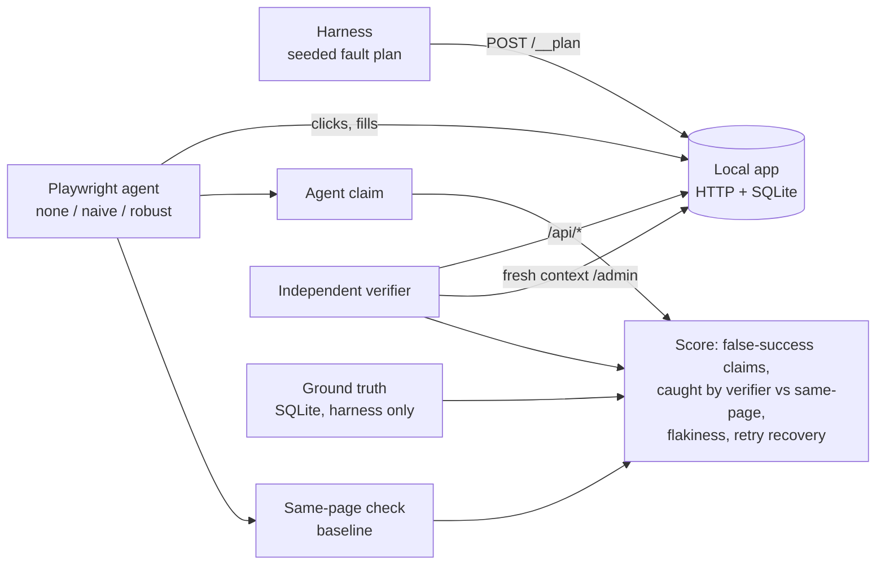

# browser-agent-verifier

A Playwright browser agent that does tasks on local test web apps (a form, a multi-page checkout, a settings page with flaky elements), with three retry policies and an **independent completion verifier**. The verifier checks the app's real state (API + fresh DOM), not the agent's claim.

## What it is
- **Test app** (`bav/app.py`): stdlib HTTP server + SQLite. Flows: `/contact` form, `/shop → /cart → /checkout → /review → /order/<id>`, `/settings` (fetch + toast). Faults are set per episode: late-rendering buttons, a swallowed first click, a click-blocking overlay, and a queue of submit outcomes: `ok`, `error` (503, nothing saved), `commit_then_error` (saved, then 503), `silent_fail` (success page or toast, nothing saved).
- **Agent** (`bav/agent.py`): a scripted plan per task (no LLM), run in real headless Chrome. It claims success when it *sees* success (URL, heading, toast).
- **Retry policies**: `none` (2.5 s timeout, no retry), `naive` (retry the failing action in place ×3), `robust` (reload the segment start, redo the segment, timeout doubles, backoff ×3).
- **Verifier** (`bav/verifier.py`): never reads the agent's page or claim. It checks the read-only API and a fresh browser context on `/admin/<table>`, and requires the exact expected effect, **exactly once**. A same-page check (re-read the agent's own page) is the weak baseline. SQLite ground truth is read only by the harness, to score both.

## Why
Agents report what they saw, not what happened. A toast that says "Saved!" while nothing was written, or a retry after a commit-then-timeout that places a second order, both look like success to the agent and to a screenshot judge. Only a check against real state catches them.

## Architecture


## How it works
1. The harness resets the app with a fault plan sampled from a seed. The same seeds are used for every policy, so the comparison is paired.
2. The agent runs the task in a new browser context and records every attempt (first-try failures, retries).
3. The same-page check, the independent verifier and SQLite ground truth are recorded per episode.
4. `bav.bench` writes `results/summary.json` and `results/episodes.jsonl`.

## Results
**Benchmark numbers: pending.** The full run (`python -m bav.bench --seeds 15`, 135 episodes) did not finish: the host Mac was overloaded (load average up to 36) and restarted mid-run. No `results/` file is committed, so this README states no rates. Run it with:

```bash
.venv/bin/python -m bav.bench --seeds 15   # writes results/summary.json + episodes.jsonl
```

**What is measured now (tests, real Chrome, 2026-11-10): 19/19 pass.** Behaviour each test confirms:
- **Silent fail** (contact, checkout, settings): the agent claims success and the same-page check agrees; the independent verifier reports *not complete*, matching ground truth.
- **Commit-then-error + retry** (contact, checkout): the retry creates a **duplicate** (2 rows). The agent claims success; the verifier flags it.
- **Settings retry is idempotent** (upsert): the same fault does not create a duplicate there.
- `none` fails on a swallowed click and on a 3.5 s late render; `naive` recovers the swallowed click; `robust` recovers both the late render and a 503.

## Tests
19 pytest tests against the real app in real headless Chrome (system `chrome` channel, so no browser download is needed).
```bash
python3 -m venv .venv && .venv/bin/pip install -r requirements.txt
.venv/bin/python -m pytest -q
```

## Limits
- Benchmark rates are not yet measured (see Results).
- Scripted agent, not an LLM planner. It tests browser mechanics and verification, not planning.
- Timing faults are sensitive to host load: under heavy load, actions without injected faults can also time out.
- The verifier needs read-only state endpoints (or DB access). Real apps may only expose this through admin APIs.
- Fault plans are synthetic (seeded sampling). The browser, HTTP, DOM and database are real.

## License
MIT
